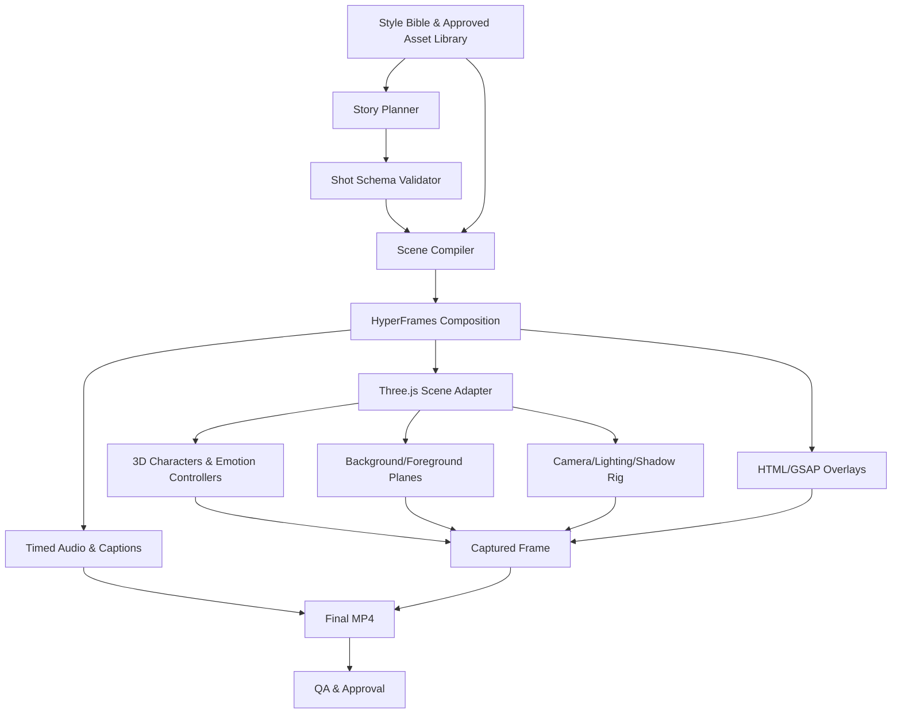

# AI Storybook Animation Studio — Workflow Audit & Reference Architecture

**Version:** 1.0  
**Date:** 14 November 2026  
**Purpose:** Review an *existing* story/video production workflow against the capabilities required for a scalable 2.5D animated children's storybook studio. This is a gap-analysis specification, **not** a request to replace the existing workflow.

## Executive decision

**Target aesthetic:** Two (or more) reusable, animation-ready **stylized 3D characters** acting in front of **AI-generated 2D storybook artwork**, optionally split into depth layers. The visual tone should follow the *design principles* of the supplied example pages: warm, rounded, expressive, dimensional illustrations, gentle cinematic light, bright but coordinated colours, simple legible silhouettes, and whimsical environments. Generate original characters and worlds rather than reproducing specific published characters.

**Recommended rendering architecture:** **Three.js** owns the 3D characters, camera, shadows and optional parallax planes; **HyperFrames** owns composition time, shot scheduling, preview/capture and export; **GSAP/HTML** handles overlays, titles and transitions where appropriate. **Blender** or an equivalent content creation pipeline produces rigged `.glb` assets. An AI planner generates *structured shot instructions*, not arbitrary one-off rendering code for every episode.

**Main implementation rule:** A Style Bible + character reference sheets are *necessary but not sufficient*. The operational asset is a validated **3D character package** (geometry, skeleton, facial rig, clips, controller mapping, thumbnail, version). The primary technical risk is making that package consistently match the illustration style, not sequencing shots in HyperFrames.

---

# Part I — How to audit the workflow you already have

### Review process

1. Locate the existing feature or code path for each check below.
2. Mark it **Implemented**, **Partial**, **Missing**, or **Not applicable**.
3. Add evidence: paths, screenshots, tests, sample outputs or CLI commands.
4. Prioritize blockers that prevent a single end-to-end scene before implementing optional enhancements.
5. Retain components that already meet the contract; only change missing or incompatible portions.

> Do **not** claim a check is implemented simply because a similarly named module exists. A testable demonstration is required.

## Functional acceptance checklist

### A. Story planning and reproducibility

- [ ] Story script splits into **scenes and shots** (not only paragraphs/pages).
- [ ] Every shot specifies duration, characters, their actions/emotions, dialogue, background, camera framing and transitions.
- [ ] Script and shot plan have a versioned, machine-readable representation.
- [ ] Shot assets and generated outputs have stable IDs, paths, provenance and regeneration status.
- [ ] A shot can be regenerated without changing unrelated shots.
- [ ] Seeds, model versions/prompts, asset versions and render settings are recorded for reproducibility where available.

### B. Style direction and consistency

- [ ] A **Master Style Bible** specifies shapes, eyes, proportions, materials, palette, lighting, backgrounds and negative examples.
- [ ] A **canonical AI-generated style calibration image** is approved and separated from photographed book pages (no incidental page text, cropping or printing artefacts).
- [ ] Style compliance is assessed across humans, furry animals, smooth-skinned animals and fantasy characters.
- [ ] There is a **hero test image** with two intended characters and one representative background.
- [ ] A scene-level lighting/look profile aligns 3D materials with the background illustration.
- [ ] The workflow can detect or route obvious style mismatches for human approval.

### C. Character authoring and asset contracts

- [ ] Each character has an identity reference and front, side, three-quarter and rear designs.
- [ ] Each has an expression sheet and pose sheet for modelling/rigging reference.
- [ ] Every reusable character ships as a validated `.glb`/glTF plus metadata, not merely PNGs.
- [ ] Body skeleton, scale, axes, pivot/feet alignment, clips and facial controls have a consistent contract.
- [ ] Base expressions include happy, sad, angry, surprised, worried, laughing and neutral.
- [ ] Body actions include idle/breathe, blink, walk, turn, point, look, nod and react; speaking gestures are separable from dialogue timing.
- [ ] Missing morph targets/clips have explicit fallback behaviour and warnings.
- [ ] Character ID/version can be pinned for a story, preventing accidental design drift.
- [ ] Runtime controls can blend between body animation and additive head/eye/facial expressions.

### D. AI-generated background assets

- [ ] Locations have canonical reference art, look/mood tags and reuse IDs.
- [ ] Backgrounds include planned **wide/medium/close** framing or are crop-safe for intended shots.
- [ ] Background image generation considers characters' staging area, eyeline and ground horizon.
- [ ] Optional sky/back/mid/front layers are available for modest parallax.
- [ ] Camera paths are limited to motions supported by the available depth information.
- [ ] A consistent ground plane/contact-shadow approach prevents floating characters.
- [ ] Parallax layers and character silhouettes do not intersect implausibly during moves.
- [ ] Background rights/provenance and image-generation parameters are tracked.

### E. Animation, emotion, acting and audio

- [ ] An **Animation Bible** defines reusable actions, emotion names, timing rules and camera vocabulary.
- [ ] An emotion controller maps semantic values to actual per-character rig morph targets/bones.
- [ ] Expressions and gestures can overlap without destructive conflicts.
- [ ] Blinking/looking/breathing is deterministic and time-based (not wall-clock random).
- [ ] Voice audio is attached per line/character with exact start/duration.
- [ ] Lip sync supports at least jaw/open-close; ideally phoneme/viseme timing and emotional mouth blending.
- [ ] Two characters can speak in sequence and react while the other speaks.
- [ ] Gestures and eye contact are timed to dialogue beats.
- [ ] Narration, dialogue, music, effects and silence have separate mix controls.
- [ ] Audio levels, transitions and captions/subtitles are checked before final export.

### F. HyperFrames / Three.js runtime

- [ ] HyperFrames controls the **authoritative time** for all render-critical animation.
- [ ] Three.js responds to **`hf-seek`** and renders at the supplied composition time.
- [ ] Three.js model and texture loading completes before capture-critical seeks.
- [ ] The composition root has explicit `data-duration` when relying on the Three.js adapter.
- [ ] GLB `AnimationMixer`s seek using absolute/local shot time (e.g., `setTime()`), with proper clip start offsets.
- [ ] Morphs, bones, cameras, shaders and parallax positions are pure/deterministic functions of time and shot data.
- [ ] No render-critical free-running `requestAnimationFrame`, wall clock delta or unseeded randomness.
- [ ] Seek to 8 s, then 2 s, then 8 s reproduces the same frame.
- [ ] Multi-shot camera cuts and object visibility use a single schedule, avoiding leakage from another shot.
- [ ] Composition dimensions, frame rate, renderer pixel ratio and colour management are fixed.
- [ ] Lint, check, preview, snapshot tests and final MP4 rendering are part of the pipeline.

### G. Editability, quality and scale

- [ ] The story remains editable at the **shot data** level without rewriting animation code.
- [ ] Backgrounds, expressions, cameras and dialogue can be replaced independently.
- [ ] A low-cost interactive preview and a high-quality final render share the same timeline semantics.
- [ ] Frames are inspected for facial drift, asset clipping, foot sliding, shadow mismatch and text collisions.
- [ ] Render failures produce actionable logs with character/asset/shot IDs.
- [ ] Asset caches and content hashes avoid repeated costly generation.
- [ ] There is a human approval step for canonical styles, character rigs and final shot selections.
- [ ] A reusable library supports new stories with different character pairs and locations.

---

# Part II — Expanded end-to-end production workflow (requested expansion #1)

Each phase includes **inputs → transformation → outputs → acceptance gate**. Run these phases against the existing workflow; don't assume new tooling is necessary.

## Phase 0 — Inventory the current workflow

**Inputs:** Existing repo, agents/skills, generation prompts, story JSON, renderer components, assets and sample videos.  
**Work:** Diagram the actual pipeline; list formats, owners and dependencies; identify manual stages. Compare each stage to Part I.  
**Outputs:** Current-state diagram, capability matrix, prioritized gap list.  
**Gate:** Can explain exactly how one scene is authored, previewed, modified and exported today.

## Phase 1 — Creative direction and canonical style

**Inputs:** Six uploaded illustration references and target audience (e.g., Year 2 children's stories).  
**Work:** Distill common visual principles, remove accidental printed-page features, generate a **new original calibration image** showing different body types in one scene. Define a limited palette, softness/roughness, eye-to-head ratio guidelines, silhouette characteristics, edge/shading style, background depth, atmosphere and lighting setups. Specify *do-not-do* cases (plastic-looking game characters, photoreal fur, generic vector art, mismatched light).  
**Outputs:** `style-bible.md`, canonical style PNGs, look profiles and negative examples.  
**Gate:** A human approves a mixed human/animal/fantasy scene as visibly belonging to one world.

**Suggested style schema** (your studio convention, not a HyperFrames API):

```json
{
  "style_id": "storybook-warm-3d-v1",
  "forms": "rounded and expressive, readable silhouettes",
  "faces": "large eyes, prominent eyebrows, expressive mouth shapes",
  "palette": "warm vibrant greens, orange, blue and earth tones",
  "materials": "softly shaded stylized surfaces, restrained specular highlights",
  "lighting": "soft cinematic key plus subtle ambient fill",
  "backgrounds": "painterly stylized forest/village environments",
  "avoid": ["photorealistic humans", "hard game-engine gloss", "printed page text"]
}
```

## Phase 2 — Story outline → structured screenplay

**Inputs:** Story premise, age/language level, planned duration, moral/comprehension goals.  
**Work:** Write narration/dialogue, identify beats/emotional turns, divide into scenes and short shots. Every shot must be physically achievable with existing character capabilities; mark any new action or prop as an asset requirement.  
**Outputs:** `story.md`, `screenplay.json`, shot list, asset demand list.  
**Gate:** Every dialogue line belongs to one shot and an explicit speaker (or narrator); total timed duration is finite.

**Example shot description** (proposed studio schema):

```json
{
  "story_id": "forest-surprise-001",
  "shots": [
    {
      "id": "s01_sh01",
      "duration_s": 6,
      "background_id": "forest-clearing-morning-v2",
      "camera": {"preset": "medium_two_shot", "move": "slow_push_in", "amount": 0.05},
      "characters": [
        {"id": "rabbit-01", "position": [-0.8, 0, 0], "action": "idle", "emotion": "worried"},
        {"id": "fox-01", "position": [0.8, 0, 0], "action": "point", "emotion": "curious"}
      ],
      "dialogue": [{"speaker": "fox-01", "text": "Look over there!", "start_s": 1.2}],
      "transition_out": "cut"
    }
  ]
}
```

## Phase 3 — Character concept and 3D production

**Inputs:** Approved Style Bible and narrative role.  
**Work:** Generate identity concept + turnaround + expression/pose sheets. Model a 3D version, unwrap/materialize, rig it, add facial controls, produce body clips, compare rendered turntable against approved images. Export `.glb` and associated controller metadata. Keep original concept references separate from final runtime assets.  
**Outputs:** `characters/<id>/model.glb`, `rig-manifest.json`, `identity.png`, turntable/test renders, licences/provenance.  
**Gate:** Same character passes neutral/angry/happy/surprised frames, walk/turn/speak test, and remains visually coherent under scene lights.

**Minimum character manifest** (proposal):

```json
{
  "id": "rabbit-01",
  "version": "1.0.0",
  "model": "model.glb",
  "units": "meters",
  "forward_axis": "+Z",
  "clips": {"idle": "Idle", "walk": "Walk", "point": "Point", "turn": "Turn"},
  "morph_targets": {
    "blink_left": "eyeBlinkLeft",
    "blink_right": "eyeBlinkRight",
    "smile": "mouthSmile",
    "jaw_open": "jawOpen",
    "brow_up": "browInnerUp",
    "brow_down": "browDown"
  },
  "look_at_bone": "Head",
  "root_motion": "in_place",
  "reference_image": "identity.png"
}
```

**Design note:** Do not assume every image-to-3D service delivers useful skeletons or facial blendshapes. The ability to animate *and* preserve the character design must be independently verified. If a facial target is absent, implement a documented fallback rather than silently ignoring the emotion.

## Phase 4 — AI artwork and scene layers

**Inputs:** Shot camera framing, blocking, style and location prompts.  
**Work:** Generate a background with an intentional empty staging area and suitable ground horizon. Where needed, split into sky, distant background, middle environment and foreground occluders; generate masks/alpha and check edges. Optionally produce wide and medium compositions rather than stretching one small image across every angle.  
**Outputs:** Background/layer PNG/WebP images, depth order, masks, lighting metadata, optional ground contact shadow catcher.  
**Gate:** Scene remains convincing at the planned start/end camera positions, with no sudden stretching or revealed gaps.

## Phase 5 — Voice, timing and lip-sync preparation

**Inputs:** Script and approved voice selection.  
**Work:** Generate/record voice audio; get timings by forced alignment or speech analysis; construct viseme or jaw-open keyframes; place reaction beats and expressive pauses. Distinguish narration from character dialogue.  
**Outputs:** Audio files, word/phoneme timing, viseme tracks, per-shot cue sheet.  
**Gate:** Speakers, spoken words, gestures and mouth action align in a preview; audio is clean and has a coherent mix.

## Phase 6 — Compile shot instructions into renderable scenes

**Inputs:** Story/shot JSON, character packages, backgrounds, sound cues, camera presets.  
**Work:** Validate references and capabilities; resolve assets and clip names; create scene graph; compute deterministic animation tracks for each shot; define timelines and transitions; register build readiness.  
**Outputs:** HyperFrames composition HTML/JS or generated project files, shot manifest, diagnostic report.  
**Gate:** Build completes without missing assets and can render an arbitrary requested frame.

## Phase 7 — Preview, edit, approval

**Inputs:** Generated composition.  
**Work:** Scrub scenes, change shot timing, facial intensity, character positioning, camera and environment; run automatic screenshot comparisons for fixed checkpoints; require human acceptance of critical character design/emotional beats.  
**Outputs:** Updated shot data, approved preview, change history.  
**Gate:** No visible foot sliding, clipping, character identity drift, broken eye contact, lip-sync mismatch, lighting discontinuity or background parallax exposure.

## Phase 8 — Deterministic render and post-production

**Inputs:** Locked scene assets/settings, captions, soundtrack.  
**Work:** Run `npx hyperframes lint`, `npx hyperframes check`, render the MP4 with your verified installed CLI invocation, validate audio/video length and frame dimensions. Do final colour/sound/caption check.  
**Outputs:** Final video, optional thumbnails, captions, asset/version manifest and render logs.  
**Gate:** An out-of-order seek produces identical frames; the export opens and has expected duration, narration and framing.

## Phase 9 — Library growth and reuse

**Inputs:** Approved shots and assets.  
**Work:** Promote reusable rigs, locations, actions, gestures, camera presets, light rigs and shot templates to versioned libraries. Capture failure patterns to improve generation prompts and validators.  
**Outputs:** Increasingly reusable building blocks; future stories need only new scripts and a small set of new assets.  
**Gate:** A second story reuses one character and one background without custom animation code changes.

---

# Part III — Concrete HyperFrames + Three.js architecture (requested expansion #3)

## 1. Responsibility boundaries

| Component | Owns | Does **not** automatically provide |
|---|---|---|
| Story planner (AI agent) | Story, shot plan, semantic actions/emotions | Rigged models or valid animation geometry |
| Asset pipeline (Blender/image tools) | Character GLBs, artwork layers, manifests | Timeline or video export |
| Scene compiler (your code) | Validated shot JSON → runtime schedule and asset references | Artistic quality without validation |
| Three.js scene runtime | GLB loading, rigs, camera, shadows, parallax, expression controller, per-time rendering | Semantic character emotions out of the box |
| HyperFrames | Seekable composition runtime, frame capture/export, composition integration | Automatic rigging, emotional performances or background depth |
| GSAP/HTML | Text, graphic overlays and scripted transitions | 3D rig semantics |
| QA/Studio UI | Review, corrections, validation | Guaranteed aesthetic quality without human review |

## 2. Runtime architecture



**Key principle:** Only *one* source of truth for time. HyperFrames decides `t`; everything visible is evaluated at `t`. Never run body animations, facial motion or the camera on independent clocks during render.

## 3. Suggested project layout

```text
storybook-studio/
├── creative/
│   ├── style-bible.md
│   ├── animation-bible.md
│   └── approved-style/
├── assets/
│   ├── characters/
│   │   └── rabbit-01/v1/
│   │       ├── model.glb
│   │       ├── rig-manifest.json
│   │       ├── identity.png
│   │       └── expressions.png
│   ├── environments/forest-clearing/v2/
│   │   ├── sky.webp
│   │   ├── background.webp
│   │   ├── foreground.webp
│   │   ├── masks/
│   │   └── scene-manifest.json
│   └── audio/
├── stories/
│   └── forest-surprise-001/
│       ├── story.md
│       ├── shots.json
│       ├── dialogue-timing.json
│       └── render-manifest.json
├── src/
│   ├── schemas/
│   ├── planning/
│   ├── compiler/
│   ├── three/
│   │   ├── scene-loader.ts
│   │   ├── character-controller.ts
│   │   ├── emotion-mapper.ts
│   │   ├── lip-sync.ts
│   │   ├── camera-presets.ts
│   │   ├── parallax-background.ts
│   │   ├── lighting.ts
│   │   └── render-at-time.ts
│   ├── hyperframes/
│   │   └── composition.html
│   └── validation/
└── tests/
    ├── seek-determinism/
    ├── character-contract/
    ├── screenshot-golden/
    └── shot-smoke/
```

## 4. Three.js scene graph: layered illustration + two 3D characters

```text
Scene
├── CameraRig
│   └── OrthographicCamera OR restrained PerspectiveCamera
├── LightingRig
│   ├── Ambient/Hemisphere fill
│   ├── soft key light (matches painted background)
│   └── optional rim light
├── BackdropGroup
│   ├── SkyPlane       (furthest image)
│   ├── FarPlane       (hills/trees)
│   ├── MidPlane       (forest/village)
│   └── ForegroundPlane (occluding plants/rocks)
├── GroundPlane (may be transparent shadow-receiving plane)
├── CharacterRootA (GLB; skeleton + blendshapes)
├── CharacterRootB (GLB; skeleton + blendshapes)
└── FXGroup (time-driven particles, mist, glow)
```

**Composition caution:** Physical depth placement, plane sizes and the camera projection need to agree. A sky at infinity and a flat ground painted into the midground will not automatically match the 3D feet. Establish a common ground line and use shadow catchers or composited contact shadows. Test occlusion when a character passes behind a bush.

## 5. Deterministic time contract with HyperFrames

The upstream HyperFrames Three.js adapter documentation describes these important mechanics:

- The adapter publishes a composition time and dispatches `hf-seek` with `event.detail.time`.
- Three.js must render from that absolute requested time, rather than wall-clock time or an unconstrained `requestAnimationFrame` loop.
- GLB clips can seek via `AnimationMixer.setTime()`.
- Render-critical assets must be loaded before seeking; a readiness promise can be registered under `window.__hf.buildReady[uniqueKey]`.
- The root element should have an explicit `data-duration="<seconds>"` for a composition relying on the Three adapter.
- Validate with `npx hyperframes lint` and `npx hyperframes check`.

**Illustrative integration sketch** (design example; wire to the precise APIs/HTML conventions supported by your installed version):

```html
<div data-composition-id="forest-shot" data-duration="6">
  <canvas id="three-layer"></canvas>
</div>
<script type="module">
  import * as THREE from 'three';

  const canvas = document.querySelector('#three-layer');
  const renderer = new THREE.WebGLRenderer({ canvas, alpha: true, antialias: true });
  renderer.setSize(1920, 1080, false);
  renderer.setPixelRatio(1);

  const scene = new THREE.Scene();
  const camera = new THREE.PerspectiveCamera(35, 1920 / 1080, 0.1, 100);
  const controllers = [];

  async function buildScene() {
    // Your code: preload backgrounds, both GLBs, animation clips,
    // controller mappings, lights, ground plane and camera presets.
    // Resolve only after the scene is genuinely drawable.
  }

  window.__hf = window.__hf || {};
  window.__hf.buildReady = window.__hf.buildReady || {};
  window.__hf.buildReady['forest-shot-assets'] = buildScene();

  function renderAtTime(t) {
    for (const character of controllers) {
      // All components must be calculated from t, not previous frame state.
      character.seek(t);
    }
    // Your code: set deterministic camera/parallax/light positions at t.
    renderer.render(scene, camera);
  }

  window.addEventListener('hf-seek', (event) => {
    renderAtTime(event.detail.time);
  });
</script>
```

**Important implementation detail:** The displayed code is deliberately a wiring example, not a runnable full scene. A production controller also needs shot-relative timing, clip mapping, animation weight resets, asset error handling, colour management and render-readiness tests. Always validate the chosen HyperFrames version.

## 6. Character controller interfaces (studio-owned)

Use a small stable semantic API rather than asking the AI to manipulate individual bones for every scene:

```ts
interface CharacterCommand {
  actorId: string;
  action?: 'idle' | 'walk' | 'point' | 'turn' | 'react';
  emotion?: 'neutral' | 'happy' | 'sad' | 'angry' | 'surprised' | 'worried';
  emotionIntensity?: number; // 0..1
  lookAt?: { x: number; y: number; z: number };
  gesture?: string;
  speechTrackId?: string;
  transform?: { x: number; y: number; z: number; yaw: number };
}

interface CharacterController {
  seek(timeSeconds: number, command: CharacterCommand): void;
  validateCapabilities(command: CharacterCommand): string[];
}
```

**Emotion mapping:** `happy` might increase `mouthSmile` and soften eyebrows; `worried` might raise inner brows, narrow mouth, tilt head; `angry` might lower brows and lean forward. The same semantic emotion must use **rig-specific mappings** per character; different character meshes cannot be assumed to share morph target names. Clip layering also needs a policy: e.g. walking controls the body, emotion controls face/head, speaking controls the jaw, look-at controls eyes, with explicit precedence for conflicts.

**Lip sync:** Prefer timed phoneme-to-viseme cues if available; a basic `jawOpen` track is acceptable for the first milestone. Mouth shape must blend with smile/frown, rather than erase emotion throughout a line.

## 7. Camera and 2.5D staging conventions

**Recommended camera presets:**

- `wide_two_shot`: both actors clearly visible, background establishes place.
- `medium_two_shot`: conversational staging with usable eyelines.
- `close_reaction_A` / `close_reaction_B`: emotional beats with background reframing.
- `walk_in`: shallow character translation across the ground.
- `reveal`: one character turns/points; cut or small camera pan reveals what they saw.

**Safe moves:** gentle push/pull, modest pan/tilt, slight parallax, cut to a separately prepared angle.  
**High-risk moves with flat art:** large orbit, severe perspective shift, moving behind painted structures, deep travelling shots. For these, generate a new background angle or build the relevant region in 3D.

**Lighting recipe:** key light direction/temperature should match the painting; add broad ambient fill, restrained rim and believable contact shadows. Avoid realistic physically sharp shadows against soft painted artwork. Match exposure, saturation, fog and grading across the 2D and 3D layers.

## 8. Timing model

For a shot that starts at global composition time `T0`:

```text
local_t = clamp(global_t - T0, 0, shot_duration)
pose(local_t) = sample_clips(local_t)
face(local_t) = emotion_track(local_t) + lip_sync_track(local_t)
camera(local_t) = camera_keyframes(local_t)
background(local_t) = parallax_keyframes(local_t)
frame(global_t) = render(all states evaluated at local_t)
```

Avoid accumulating incremental transforms from preceding frames. Seeking forward, backwards or repeatedly to the same instant must produce the same result. Seed procedural blinks/particles and calculate state directly from time and stable IDs.

## 9. Editing and preview contract

Expose editable *data*, not just rendered pixels:

- Story view: narration/dialogue and shot order.
- Shot view: cast, location, action, emotion, gesture, blocking and camera preset.
- Timeline view: per-actor tracks, dialogue/waveforms, emotion keyframes, camera and transition tracks.
- Visual preview: play/pause/scrub/frame-step, face and scene lighting inspection.
- Asset inspector: rig version, available actions, morph controls, missing dependencies.
- Export panel: resolution, FPS, duration, audio, captions, diagnostics.

Use HyperFrames Studio where its capabilities fit; separate bespoke controls only when required for scene data or rigs. HyperFrames' Studio documentation states that preview and render operate on a shared seekable composition contract, although heavy real-time preview may stutter while offline frame capture remains correct.

## 10. Minimal build plan / proof of concept

Build **one 15–30 second sample** without redesigning the whole workflow:

1. Two original stylized character concepts approved against the Style Bible.
2. Two rigged `.glb` files with `idle`, a gesture, head turn, blink, smile/frown and jaw open.
3. One painted forest clearing with a staging area, optionally one foreground foliage layer.
4. Three shots: wide conversation → medium pointing reaction → close emotional reveal.
5. One dialogue exchange with aligned speaking/mouth opening and a reaction from the listener.
6. Gentle push-in, matched lighting, contact shadows and a transition/cut.
7. HyperFrames seeks reproducibly to all frames; final MP4 has correct audio and duration.
8. One edit (change character emotion or camera speed) works by altering shot data only.

### Proof-of-concept acceptance tests

| Test | Pass criterion |
|---|---|
| Visual identity | Both character designs match their approved sheets throughout |
| Style blend | Characters look integrated, not pasted/game-like |
| Expression | Worried → surprised → happy is visually clear without swapping character images |
| Performance | Both actors move/react independently; eye lines are credible |
| Speech | Mouth motion starts/stops with the correct speaker |
| Camera | No broken background perspective or uncovered canvas |
| Shadow | Character feet have believable ground contact |
| Seekability | Snapshot at 8s identical after seeking 8 → 2 → 8 |
| Editability | Emotion strength or camera push changes without hand-editing low-level scene JS |
| Export | MP4 renders successfully at chosen FPS/dimensions and has expected audio |

---

# Part IV — Prioritised gap analysis for an existing workflow

Use this to decide what to change in your current codebase.

## P0 — Must exist for the first complete animated scene

- [ ] Story/shot data format with explicit timestamps.
- [ ] Approved style reference / visual match test.
- [ ] Two working rigged 3D assets with at least basic facial controls.
- [ ] Character controller resolving actions and morph mappings.
- [ ] Background + character compositing, camera, lighting and ground contact.
- [ ] HyperFrames time → deterministic Three.js render.
- [ ] Voice/dialogue cue timing and basic speaking mouth movement.
- [ ] Asset readiness, lint/check, preview and final MP4 export.

## P1 — Necessary to scale beyond a single demonstration

- [ ] Style Bible and Animation Bible stored as versioned documents.
- [ ] Reusable actor/location library with manifests and validation.
- [ ] Emotion + gesture tracks, mouth viseme support and shot-relative time.
- [ ] Scene compiler/validator, asset hashes, version locking, reproducible config.
- [ ] Parallax layering, occlusion and reusable shot/camera presets.
- [ ] Edit controls for story, blocking, timing, emotion and camera.
- [ ] Golden-frame comparison and acceptance workflow.

## P2 — Nice to have once production works

- [ ] AI-assisted 3D asset generation and automatic rig quality scoring.
- [ ] Automated shot suggestions and camera selection.
- [ ] More advanced phoneme/viseme and facial coarticulation.
- [ ] Physics-like cloth/secondary motion (must remain seekable).
- [ ] Depth-estimated backgrounds, generated layers and complex camera moves.
- [ ] Render queue, distributed capture, cost/performance dashboard and bulk episode batching.

## Existing-workflow review table (fill in)

| Area | Current implementation / evidence | Status (Implemented / Partial / Missing) | Required change | Priority |
|---|---|---|---|---|
| Story/shot schema | | | | P0 |
| Style Bible & reference library | | | | P1 |
| 3D character asset pipeline | | | | P0 |
| Facial rig and expression mapping | | | | P0 |
| Body movement & gestures | | | | P0 |
| Speech timing & lip sync | | | | P0 |
| Background layers & camera limits | | | | P0 |
| Lighting & contact shadow | | | | P0 |
| HyperFrames integration | | | | P0 |
| Deterministic seeks | | | | P0 |
| Timeline editing UI | | | | P1 |
| Lint/check/render QA | | | | P0 |
| Versioned reusable asset library | | | | P1 |

---

# Part V — Recommended instructions for a coding agent auditing the current system

> Inspect the existing repository **without replacing its working architecture by default**. Map its actual story authoring, asset generation, 3D character runtime, HyperFrames composition, preview and render pipeline to Parts I–IV of this specification. For every checklist item, give: (1) status — implemented/partial/missing, (2) exact file paths/functions and a runnable proof where possible, (3) specific gaps, (4) the smallest compatible change, (5) severity P0/P1/P2. Identify where assumptions about HyperFrames or Three.js are unsupported. Test that the scene uses composition-time `hf-seek`, preloads assets, specifies valid duration and supports reproducible out-of-order seeks. Propose a phased implementation plan and the smallest 15–30 second two-character proof of concept. **Do not start a rewrite until the audit identifies genuine blockers.**

---

# References and verification notes

The project-specific statements below were verified against the public HyperFrames repository/documentation on **14 November 2026**. They are separate from the **proposed studio conventions** above (JSON schemas, emotion-controller API, manifest format, library layout, UI and QA design), which you would need to implement yourself.

1. HyperFrames project / CLI / agent-oriented HTML-to-video workflow: https://github.com/heygen-com/hyperframes
2. Official Three.js integration guidance (`hf-seek`, readiness, `data-duration`, mixer seeking, lint/check): https://github.com/heygen-com/hyperframes/blob/main/skills/hyperframes-animation/adapters/three.md
3. Frame adapter contract and arbitrary frame seeking: https://github.com/heygen-com/hyperframes/blob/main/docs/concepts/frame-adapters.mdx
4. Deterministic frame capture rules: https://github.com/heygen-com/hyperframes/blob/main/docs/concepts/determinism.mdx
5. HyperFrames Studio preview/edit architecture: https://github.com/heygen-com/hyperframes/blob/main/docs/packages/studio.mdx

**Version caveat:** Consult the adapter and CLI documentation shipped with the exact HyperFrames version installed in your project. Some older docs describe timeline/duration mechanisms differently; for the Three adapter, follow the version-matched Three guide rather than mixing contracts from older core docs.
